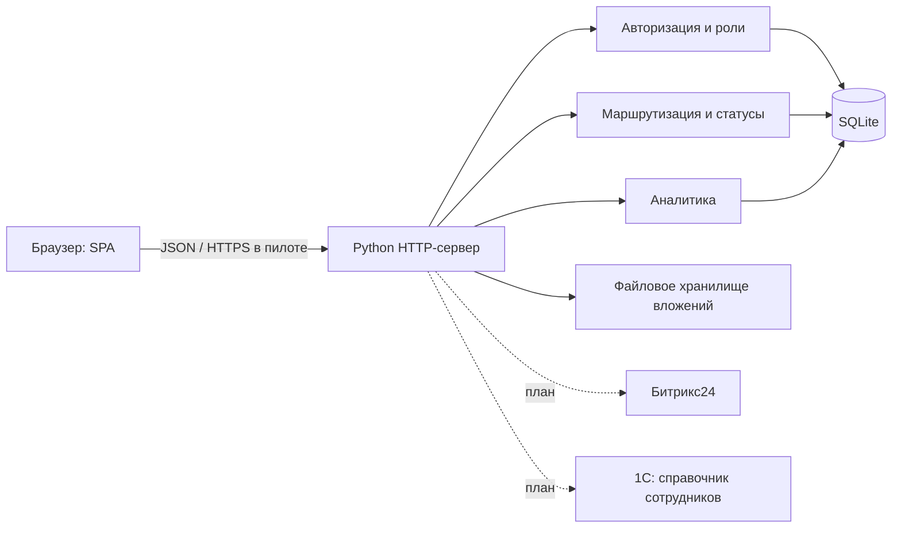

# Продуктовая и техническая концепция

**Система обратной связи и предложений сотрудников ГК «Модус Трейд»**
Документ к защите хакатона. Демонстрируемое решение — работающий MVP в папке проекта.

---

## 1. Проблема и ценность

В компании работают продажи, закупки, проектирование, IT, сервис и управляющие
функции. Проблемы и идеи возникают в ежедневной работе, но у них нет единого
канала: часть теряется в чатах и личных обсуждениях, часть повторяется, а решения
не фиксируются. Сотрудник не понимает, дошло ли обращение и что с ним происходит;
руководитель не видит системной картины.

**Что меняет продукт**

| Было | Стало |
|---|---|
| проблема обсуждается в чате и теряется | обращение регистрируется, получает номер и ответственного |
| непонятно, кто должен реагировать | маршрутизация по категории, fallback на администратора |
| статус неизвестен автору | прозрачная карточка: статус, срок, история, результат |
| решения не сохраняются | фиксируются результат, причина отказа и дата закрытия |
| повторяющиеся проблемы незаметны | аналитика по категориям и повторяющимся проблемам |
| улучшения не видны сотрудникам | раздел «Реализованные улучшения» |

**Бизнес-эффект:** меньше потерянных обращений и повторных уточнений, короче путь
до ответственного, выше прозрачность, накапливается база решений для улучшения
процессов.

---

## 2. Пользователи и роли

| Роль | Потребность | Возможности в MVP |
|---|---|---|
| Сотрудник | быстро сообщить о проблеме и видеть результат | создать обращение, видеть ленту и свои обращения, комментировать свои, читать результат |
| Руководитель / ответственный | рассматривать обращения и фиксировать решения | видеть все обращения, брать в работу, переназначать, менять статус, писать публичные и внутренние комментарии, смотреть аналитику |
| Администратор | управлять правилами и доступом | всё выше + категории, ответственные, включение/отключение категорий, автор анонимных обращений |
| Клиент | обратная связь и опросы | не входит в MVP, предусмотрено развитием |

### Матрица доступа

| Действие | Сотрудник | Руководитель | Администратор |
|---|---|---|---|
| Создать обращение | да | да | да |
| Видеть ленту обращений | да (кроме автора анонимных) | да | да |
| Видеть внутренние комментарии | нет | да | да |
| Комментировать обращение | своё | любое | любое |
| Менять статус / результат | нет | ответственный по обращению | да |
| Назначать ответственного | нет | да | да |
| Категории и маршрутизация | нет | просмотр | управление |
| Аналитика и CSV | нет | да | да |
| Видеть автора анонимного обращения | только своё | нет | да |

**Решение по прозрачности.** Лента открыта всем сотрудникам: это снижает барьер
и показывает, что проблемы решаются. Конфиденциальные обсуждения выносятся во
внутренние комментарии. В промышленной версии лента ограничивается подразделением
или кругом подписчиков — это настройка, а не переработка модели.

**Анонимность.** Необязательный режим. Автор скрывается в ленте, карточке и
комментариях от руководителей; администратор видит автора для контроля
злоупотреблений. Ограничение: подразделение, стиль и вложения могут косвенно
указать на автора — поэтому в интерфейсе есть предупреждение, а для пилота
рекомендуется не прикладывать документы к анонимным обращениям.

---

## 3. Ключевые сценарии

**Сценарий 1. Сотрудник сообщает о проблеме**
1. Выбирает тип «Проблема» и категорию.
2. Формулирует заголовок и описание, при необходимости — ожидаемое решение и файл.
3. Может включить анонимность.
4. Система присваивает номер, рассчитывает срок по приоритету и назначает
   ответственного по категории.
5. Сотрудник видит карточку со статусом, сроком и ответственным, получает
   обновления в истории.

**Сценарий 2. Руководитель рассматривает обращение**
1. Видит обращение в ленте или в просроченных.
2. Берёт в работу (становится ответственным) или переназначает.
3. Уточняет детали публичным комментарием или переводит в «Ожидает уточнения».
4. Фиксирует результат: «Реализовано», «Отклонено» (с причиной) или «Закрыто».
5. Автор видит результат и историю.

**Сценарий 3. Нет ответственного по категории**
1. Администратор не назначил ответственного или сотрудник деактивирован.
2. Обращение автоматически направляется администратору.
3. В истории остаётся запись «Автоназначение администратору (причина)».
4. Обращение не теряется; администратор назначает ответственного.

**Сценарий 4. Повторяющаяся проблема**
1. В аналитике категория с 2+ проблемами попадает в блок «Повторяющиеся проблемы».
2. Руководитель открывает обращения и инициирует системное улучшение.
3. После реализации обращения закрываются с результатом, а улучшение видно в
   разделе «Реализованные улучшения».

**Сценарий 5. Администратор настраивает маршрутизацию**
1. Создаёт категорию и назначает ответственного.
2. Отключает устаревшую категорию — новые обращения по ней не создаются.
3. Меняет ответственного — новые обращения идут новому сотруднику.

---

## 4. Состав MVP и границы

**В MVP**
- создание, регистрация, коды обращений;
- типы, категории, приоритеты, SLA;
- маршрутизация по категории + fallback;
- роли и разграничение доступа;
- жизненный цикл статусов, результат и причина отказа;
- комментарии, внутренние заметки, история событий;
- вложения до 2 МБ;
- анонимная подача;
- поиск и фильтры (тип, статус, категория, приоритет, подразделение, «мои»,
  «просроченные»);
- аналитика и CSV;
- администрирование категорий.

**Осознанно вне MVP**
- email/Telegram/push-уведомления;
- автоматическая эскалация и перерасчёт SLA по календарю;
- SSO/LDAP, 2FA;
- интеграции с Битрикс24 и 1С;
- конструктор опросов, NPS, клиентская обратная связь;
- полнотекстовый поиск и BI-отчёты;
- мобильное приложение.

Это позволяет проверить основную гипотезу — сотрудники будут пользоваться каналом,
а руководители успеют и захотят рассматривать обращения — без интеграционных
рисков.

---

## 5. Процесс рассмотрения

### Статусы

| Статус | Смысл | Кто меняет |
|---|---|---|
| Новое | зарегистрировано, ответственный назначен | система |
| На рассмотрении | ответственный изучает обращение | ответственный |
| В работе | идёт решение | ответственный |
| Ожидает уточнения | нужен ответ автора | ответственный |
| Реализовано | улучшение внедрено, есть результат | ответственный |
| Отклонено | есть мотивированная причина | ответственный |
| Закрыто | обращение завершено без отдельного внедрения | ответственный |

Переход в «Реализовано», «Отклонено» или «Закрыто» требует текста результата
(минимум 10 символов). Это защищает от формального закрытия. При завершении
фиксируется `closed_at`; при возврате в работу дата закрытия сбрасывается.

### Сроки и просрочка

| Приоритет | Срок реакции |
|---|---|
| Высокий | 3 дня |
| Средний | 7 дней |
| Низкий | 14 дней |

Срок рассчитывается от даты создания. Просрочка = срок истёк, а статус не финальный.
Она подсвечивается в ленте, карточке, KPI и отдельном списке. Автоматической
эскалации в MVP нет — это первый шаг развития.

### Как обращение не теряется

1. Обязательная категория → всегда есть правило маршрутизации.
2. Нет ответственного → fallback на администратора + запись в истории.
3. Любое изменение статуса и результата — событие в истории.
4. Просроченные обращения видны руководителю и администратору в аналитике.
5. Закрытие без результата запрещено.
6. Автор всегда видит итог, включая мотивированный отказ.

---

## 6. Данные

Синтетический датасет хакатона загружен в демо-базу и дополнен анонимным
обращением для проверки режима. Реальные клиентские и коммерческие данные не
используются.

**Основные сущности**

| Таблица | Назначение |
|---|---|
| `users` | сотрудники, роли, подразделения, хеши паролей |
| `categories` | категории, ответственный, активность |
| `appeals` | обращения, сроки, статусы, результат, вложение |
| `comments` | публичные и внутренние комментарии |
| `events` | история: регистрация, маршрутизация, статусы, решения |
| `sessions` | серверные сессии (хеш токена, срок) |

Связи: пользователь 1—N обращения (автор), пользователь 1—N обращения
(ответственный), категория 1—N обращения, обращение 1—N комментарии и события.

---

## 7. Архитектура и технологии

**Компоненты**
- `app.py` — REST API, сессии, проверка прав, бизнес-правила, аналитика, CSV;
- `storage.py` — схема, демо-данные, PBKDF2;
- `static/*` — SPA без сборки: роутинг по hash, экраны, формы, графики на CSS;
- SQLite в режиме WAL + файлы вложений на диске.

**Почему так**
- только стандартная библиотека — запуск одной командой на любом ноутбуке жюри;
- нет сборки и зависимостей — меньше рисков на демо;
- SQLite и файлы — достаточно для пилота и честно отражают ограничения;
- тонкий backend и явные REST-контракты упрощают переход на промышленный стек.

**Путь в промышленную эксплуатацию:** PostgreSQL, FastAPI/Django, объектное
хранилище, SSO, очередь уведомлений, reverse proxy и HTTPS, контейнеризация,
резервное копирование, мониторинг. Модель данных и API при этом сохраняются.

---

## 8. Безопасность и конфиденциальность

- PBKDF2-HMAC-SHA256 (120 000 итераций, соль на пользователя);
- серверные сессии, случайный токен, HttpOnly + SameSite=Lax, TTL 12 часов;
- в БД хранится SHA-256 токена, а не сам токен;
- проверка ролей и владения на каждом эндпоинте;
- параметризованный SQL, экранирование вывода, CSP;
- ограничение тела запроса и вложений, белый список расширений;
- защита от path traversal;
- для пилота: HTTPS, SSO, антивирусная проверка файлов, аудит действий,
  ограничение ленты подразделением, rate limiting.

**Данные.** Допускается только синтетика или данные с разрешением. В интерфейсе
создания есть напоминание не указывать персональные данные клиентов и коммерческие
условия.

---

## 9. Интеграции (план)

В MVP интеграции не реализованы: они не нужны для проверки основного сценария.
Точки расширения уже есть — события и назначенные ответственные.

### Битрикс24

| Параметр | Значение |
|---|---|
| Цель | уведомления и задачи ответственным, обратная синхронизация статусов |
| Данные | код, тема, категория, приоритет, ответственный, срок, статус, ссылка |
| Направление | Модус → Битрикс24 (создание задачи/уведомления), Битрикс24 → Модус (статус, комментарий) |
| Способ | REST API Битрикс24, вебхук или OAuth-приложение, сопоставление сотрудников по email/ID |
| Уточнить | права приложения, ответственные за синхронизацию, правила конфликтов статусов, персональные данные |

### 1С и корпоративные системы

| Параметр | Значение |
|---|---|
| Цель | актуальный справочник сотрудников, подразделений и ответственных |
| Данные | ФИО, подразделение, должность, роль, активность |
| Направление | 1С → Модус, периодическая синхронизация (например, раз в сутки) |
| Способ | выгрузка API/файл, идентификатор сотрудника как ключ |
| Уточнить | доступные поля, частоту, владельца данных, правила увольнения и переназначения |

### Уведомления

Каналы: email, Telegram, корпоративный мессенджер. События: регистрация,
назначение, новый комментарий, приближение срока, просрочка, смена статуса,
результат. Реализуется очередью и шаблонами; в MVP заменено лентой и карточкой.

---

## 10. Аналитика и метрики

**Сейчас в MVP**
- всего обращений, в работе, просрочено;
- доля рассмотренных (финальные / все);
- среднее время первого ответа (часы);
- среднее время до результата (дни);
- реализовано и отклонено;
- распределение по статусам, типам, приоритетам, категориям;
- динамика создания по неделям;
- повторяющиеся проблемы (2+ проблемы в категории);
- просроченные обращения и реализованные улучшения;
- экспорт CSV.

**Как проверять полезность**
1. Пилот на 2 подразделениях, 4–6 недель.
2. Базовая линия: сколько проблем сейчас фиксируется и как быстро отвечают.
3. Целевые ориентиры: доля рассмотренных ≥ 80%, первый ответ ≤ 2 рабочих дней,
   доля просрочки ≤ 10%, ≥ 50% сотрудников хотя бы раз воспользовались каналом.
4. Опрос после пилота: понятность, скорость ответа, доверие к анонимности.
5. Решение о развитии — по фактическому использованию и качеству результатов,
   а не по количеству созданных обращений.

---

## 11. Дальнейшее развитие

| Этап | Содержание | Зачем |
|---|---|---|
| MVP (готово) | канал, маршрутизация, статусы, роли, аналитика | проверить спрос и процесс |
| Этап 2 | уведомления, SSO, эскалация SLA, ограничение ленты подразделением, антивирус, аудит | пилот в компании |
| Этап 3 | интеграции Битрикс24 и 1С, мобильная версия, шаблоны ответов, база знаний улучшений | встроить в цифровую среду |
| Этап 4 | опросы, NPS, клиентская обратная связь, BI, прогноз повторяющихся проблем | развитие продукта |

---

## 12. Допущения и ограничения

1. Демонстрационные данные синтетические; выводы по метрикам — иллюстративные.
2. Роли упрощены: «руководитель» одновременно является ответственным; в пилоте
   потребуется матрица подразделений.
3. SLA фиксирован и считается в календарных днях; пауза «Ожидает уточнения» не
   останавливает срок.
4. Анонимность защищает интерфейс, но не устраняет косвенную деанонимизацию.
5. Поиск простой, без морфологии и полнотекстового индекса.
6. Уведомления не отправляются; статус виден в ленте и карточке.
7. SQLite и один процесс — ограничение пилота, не промышленной нагрузки.
8. Интеграции описаны, но не реализованы; API и события готовы к подключению.
9. Файлы не проверяются антивирусом; в пилоте — только доверенные документы.
10. Автоматическая эскалация не реализована: просрочка только отображается.

---

## 13. Соответствие требованиям ТЗ

| Требование ТЗ | Как закрыто |
|---|---|
| Продуктовая концепция и ценность | разделы 1–4 |
| Целевые пользователи и сценарии | разделы 2–3 |
| Прототип с основными экранами | работающий SPA: вход, лента, создание, карточка, аналитика, настройки |
| Сквозные сценарии | `DEMO.md`, автотесты `tests/smoke_test.py` |
| Техническая концепция, данные, безопасность | разделы 6–8 |
| Интеграции и ограничения | разделы 9, 12 |
| MVP и этапы развития | разделы 4, 11 |
| Аналитика и показатели | раздел 10 |
| Тестовые данные | датасет хакатона в `storage.py`, кнопка сброса |
| Инструкция запуска | `README.md`, `start.bat` |

**Ключевые ответы для защиты**
- *Какую задачу решает?* Даёт единый канал и управляемый процесс рассмотрения,
  снижая потери обращений и повторяющиеся ручные уточнения.
- *Как работает?* Сотрудник создаёт обращение → маршрутизация по категории →
  ответственный ведёт статус и фиксирует результат → автор видит итог → система
  считает аналитику.
- *Как развивать?* Уведомления и SSO, затем Битрикс24/1С, затем опросы и
  клиентская обратная связь; архитектура и модель данных это выдерживают.
